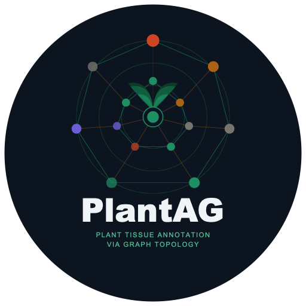

<p align="center">
  
</p>

# PlantAG: Plant Tissue Annotation via Graph Topology

[](https://github.com/MorillaLab/PlantAG/actions/workflows/tests.yml)
[](https://doi.org/10.5281/zenodo.XXXXXXX)

PlantAG imputes cell types in plant spatial transcriptomics **without a single-cell reference**. Plant tissues rarely
have a reference atlas, and spot-based arrays mix several cells per spot. PlantAG therefore describes every spot by the
**shape of the expression landscape around it**, summarised with persistent homology, and learns cell types with a graph
convolutional network guided by literature-curated marker lists.

PlantAG was developed for, and first applied in:

> Luna, A. M., Aberbache, M. et al. *Spatial transcriptomics with PlantAG reveals a tissue-wide response of tomato
> leaves to Tomato yellow leaf curl virus* (submitted). Analyses: [MorillaLab/tylcv-tomato-visium](https://github.com/MorillaLab/tylcv-tomato-visium)

## How it works

1. **Expression space.** Raw counts are normalised (shifted logarithm). The 4,000 most deviant genes, from analytic
   Pearson residuals, are reduced to 50 principal components.
2. **Local topology.** For each spot, a Vietoris–Rips filtration of the spot and its 29 nearest neighbours in that space
   gives persistence diagrams of components (H₀) and loops (H₁). These are vectorised as persistence images and
   complemented by 40 cubical-complex descriptors.
3. **Training labels.** Literature marker lists are scored on every spot. Each Leiden cluster of the persistence images
   receives the type with the highest mean score.
4. **Graph convolution.** A cosine 30-nearest-neighbour graph on expression components, persistence images and
   descriptors feeds a three-layer graph convolutional network (256 units) trained on 80% of spots.
5. **Output.** A cell type for every spot and a 256-dimensional latent embedding.

Full defaults and the reasoning behind them: [docs/method.md](docs/method.md).

## Installation

```bash
pip install torch --index-url https://download.pytorch.org/whl/cpu   # or the CUDA build for your system
pip install git+https://github.com/MorillaLab/PlantAG.git
```

Google Colab already provides PyTorch; there, `pip install git+https://github.com/MorillaLab/PlantAG.git` is enough.

## Quick start

```python
import scanpy as sc
import plantag

adata = sc.read_h5ad("visium_raw_counts.h5ad")      # X: raw counts; obs["sample"]: capture area
markers = plantag.load_markers("json_data")          # tomato leaf lists, or any {cell type: [genes]} dictionary
adata, result = plantag.run_plantag(adata, markers, seed=0)
adata.obs["predicted_cell_type"].value_counts()
```

The steps are also available one by one (`plantag.preprocessing`, `plantag.compute_topology`, `plantag.labels`,
`plantag.model`). [examples/tomato_leaf_TYLCV_notebook.ipynb](examples/tomato_leaf_TYLCV_notebook.ipynb) is the Colab
notebook used for the article.

## Outputs

| Field | Content |
|---|---|
| `obs["predicted_cell_type"]` | PlantAG cell type of each spot |
| `obs["pseudo_cell_type"]`, `obs["tda_leiden"]` | training labels and the Leiden clusters they came from |
| `obsm["X_gnn_embed"]` | 256-dimensional latent embedding (third graph-convolution layer) |
| `obsm["images_vec1"]`, `obsm["tda_features_final"]`, `obsm["X_tda_pca"]` | persistence images, scalar descriptors, their principal components |
| `obsm["X_pca"]`, `var["highly_deviant"]` | expression components and the genes behind them |

More detail: [docs/outputs.md](docs/outputs.md).

## Using PlantAG well

- **Evaluate on held-out capture areas,** not on random spots. Spots of one capture area are spatially correlated, so a
  random split is optimistic. The analysis notebook of the article implements this, together with expression-only
  baselines and a random-marker-list null.
- **Compare datasets of similar depth.** Type assignments depend on capture depth; in the article, re-running PlantAG at
  a uniform 100 UMIs per spot gave a different partition. `run_plantag(..., thin_to_median_umis=N)` matches depth
  before a comparison.
- **Names come from the marker lists.** Treat them as provisional until confirmed independently, for example by *in situ*
  hybridisation.
- **Reproducibility.** With fixed `seed` and `device="cpu"`, results are identical between runs.

## Known issues

The tomato leaf marker lists are kept exactly as used in the article, including three gene names joined by a missing
comma (for example `LOC101264905WER` in Trichomes). Correcting them changes the training labels, so it is left to a
future release.

## Citation

Please cite the article above and this software ([CITATION.cff](CITATION.cff)).

## Licence

MIT, see [LICENSE](LICENSE).
