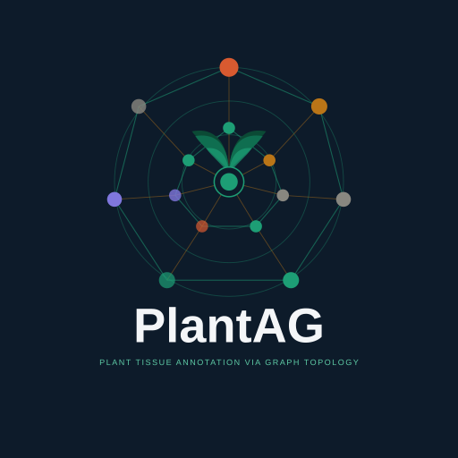
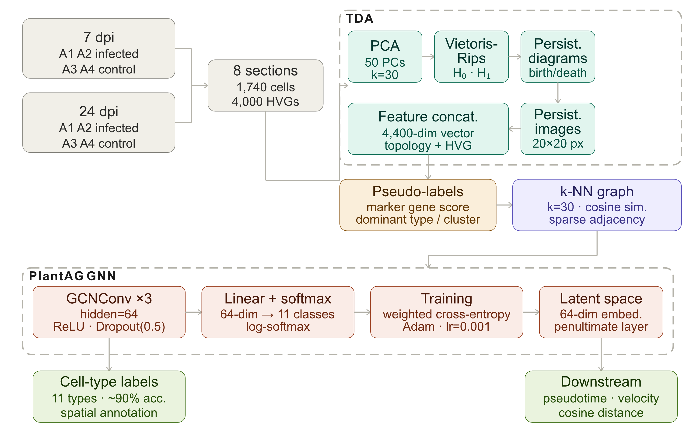

<div align="center">



# PlantAG

### Plant Tissue Annotation via Graph Topology

**Automated cell-type annotation for plant spatial transcriptomics — no reference atlas required**

[](LICENSE)
[](https://python.org)
[](https://pytorch.org)
[](https://pytorch-geometric.readthedocs.io)
[](https://giotto-ai.github.io/gtda-docs/)
[](https://github.com/MorillaLab/PlantAG/actions)
[](https://doi.org/10.5281/zenodo.19048604)

*Introduced in Luna\*, Aberbache\* et al. — TYLCV Cell Atlas (2026)*
<br>
*MorillaLab · IHSM-UMA-CSIC, Université Sorbonne Paris Nord*

</div>

---

## What PlantAG does

Plant spatial transcriptomics has a fundamental annotation problem: the automated tools that work for human and mouse data all depend on reference cell-type atlases — and those atlases don't exist for most plant species.

**PlantAG solves this.** It annotates cell types in plant spatial transcriptomics data using two ideas:

1. **Topology as a fingerprint.** Rather than relying only on gene expression, PlantAG computes the topological structure of each cell's neighbourhood in PCA space using Vietoris-Rips persistent homology. This produces a 400-dimensional persistence image that captures the local geometry of the transcriptional manifold — a signal that is biologically informative and invisible to standard clustering methods.

2. **Context via message passing.** A 3-layer Graph Convolutional Network propagates information across a cosine-similarity cell graph, so each cell's identity is refined not just by its own expression but by its transcriptional neighbourhood. This mirrors the biology: plant cell identity is maintained through positional cues and symplastic communication with adjacent cells.

The result: **~90% annotation accuracy** across ten tomato leaf cell types, trained entirely on computationally derived pseudo-labels — no manual curation, no reference atlas.

---

## Install

```bash
pip install planttag
```

Or from source:

```bash
git clone https://github.com/MorillaLab/PlantAG.git
cd PlantAG
pip install -e .
```

### Requirements

| Package | Version |
|---------|---------|
| Python | ≥ 3.9 |
| PyTorch | ≥ 1.13 |
| torch-geometric | ≥ 2.2 |
| gudhi | ≥ 3.7 |
| giotto-tda | ≥ 0.5 |
| scanpy | ≥ 1.9 |
| anndata | ≥ 0.9 |
| numpy | ≥ 1.23 |
| scipy | ≥ 1.9 |

---

## Quickstart

```python
import scanpy as sc
from planttag import PlantAG, compute_features, build_graph, pseudo_labels

# 1. Load your AnnData (Visium or compatible)
#    Requires: normalised expression + PCA computed
adata = sc.read_h5ad("my_spatial_data.h5ad")

# 2. Define marker genes for your cell types
#    (or use the built-in tomato leaf markers)
from planttag.labels import TOMATO_LEAF_MARKERS
marker_genes = TOMATO_LEAF_MARKERS  # swap for your species

# 3. Run the full pipeline in one call
adata = PlantAG.annotate(
    adata,
    marker_genes=marker_genes,
    n_pcs=10,
    k=30,
    hidden_channels=64,
    epochs=200,
)

# Cell-type predictions are now in adata.obs["planttag_celltype"]
# Latent embeddings are in adata.obsm["X_planttag"]
print(adata.obs["planttag_celltype"].value_counts())
```

Or step by step:

```python
from planttag import PlantAG
from planttag.tda import compute_persistence_images
from planttag.graph import build_knn_graph
from planttag.labels import generate_pseudo_labels, compute_class_weights
import torch

# TDA features
pi = compute_persistence_images(adata, n_pcs=10, n_neighbours=30)

# Pseudo-labels
labels = generate_pseudo_labels(adata, marker_genes, leiden_res=0.5)
weights = compute_class_weights(labels, n_classes=len(marker_genes))

# Graph
graph = build_knn_graph(adata, pi, k=30)

# Model
model = PlantAG(in_channels=4400, hidden_channels=64, num_classes=10)
model.fit(graph, torch.tensor(labels), class_weights=weights, epochs=200)

# Predict
predictions, latent = model.predict(graph)
adata.obs["planttag_celltype"] = predictions
adata.obsm["X_planttag"] = latent

# Skip training — use pre-trained weights (tomato leaf, 10 types)
model = PlantAG.from_pretrained("planttag/weights/planttag_tomato.pt")
```

---

## Architecture

<div align="center">



</div>

**Why 3 layers?**
Three message-passing steps allow each cell to aggregate information from cells up to 3 hops away — sufficient to propagate spatial and transcriptional context across the tissue without over-smoothing.

| Layers | Accuracy |
|--------|---------|
| 1 | 82.4% |
| 2 | 87.3% |
| **3** | **90.1%** |
| 4 | 88.6% |

**Why topology?**
Vietoris-Rips persistent homology captures the *shape* of the transcriptional manifold around each cell — loop-like and cluster-like features that standard dimensionality reduction cannot represent. In TYLCV-infected tissue, infected cells show significantly more high-persistence H₁ features than controls: a topological signature of viral reprogramming that differential expression analysis cannot detect.

---

## The latent space

The 64-dimensional penultimate-layer embeddings (`adata.obsm["X_planttag"]`) are not just an intermediate computation — they are a biologically meaningful representation of cellular state that encodes continuous transcriptional relationships between cell types.

```python
import scanpy as sc

# Compute diffusion map on PlantAG latent space
sc.pp.neighbors(adata, use_rep="X_planttag")
sc.tl.diffmap(adata)
sc.tl.dpt(adata, n_dcs=10)  # diffusion pseudotime

# RNA velocity on PlantAG embedding
import scvelo as scv
scv.tl.velocity_graph(adata, basis="X_planttag")
scv.pl.velocity_embedding_stream(adata, basis="planttag")
```

---

## Repository structure

```
PlantAG/
│
├── planttag/
│   ├── __init__.py           # PlantAG.annotate() — one-call API
│   ├── model/
│   │   └── gcn.py            # GCNConv architecture + fit/predict
│   ├── tda/
│   │   └── features.py       # Vietoris-Rips → persistence images
│   ├── graph/
│   │   └── builder.py        # k-NN graph (cosine similarity, PyG)
│   ├── labels/
│   │   ├── scoring.py        # Marker gene z-score pseudo-labelling
│   │   └── markers.py        # TOMATO_LEAF_MARKERS + helpers
│   └── weights/
│       └── planttag_tomato.pt  # Pre-trained weights (10 tomato cell types)
│
├── tests/
│   ├── test_tda.py
│   ├── test_graph.py
│   ├── test_model.py
│   └── test_pipeline.py
│
├── docs/
│   ├── installation.md
│   ├── quickstart.md
│   ├── api_reference.md
│   └── extending_to_new_species.md
│
├── examples/
│   ├── tomato_leaf.ipynb     # Full TYLCV atlas annotation walkthrough
│   └── new_species.ipynb     # Adapting PlantAG to a new plant species
│
├── assets/
│   └── planttag_logo.svg
│
├── setup.py
├── pyproject.toml
├── environment.yml
├── requirements.txt
└── README.md
```

---

## Extending to a new plant species

PlantAG is not tomato-specific. The architecture and hyperparameters generalise; only the marker gene sets need updating.

```python
from planttag.labels import generate_pseudo_labels

# Define markers for your species and cell types
my_markers = {
    "Epidermis":    ["AT1G01780", "AT2G26250"],   # Arabidopsis example
    "Vasculature":  ["AT5G66390", "AT3G01010"],
    "Mesophyll":    ["AT1G29930", "AT5G38430"],
    # ...
}

labels = generate_pseudo_labels(adata, marker_genes=my_markers, leiden_res=0.5)
model = PlantAG(in_channels=4400, hidden_channels=64, num_classes=len(my_markers))
model.fit(graph, labels)
```

See `docs/extending_to_new_species.md` and `examples/new_species.ipynb`.

---

## Benchmarks

Tested on tomato leaf spatial transcriptomics (Visium, 1,740 cells, 10 cell types):

| Metric | Value |
|--------|-------|
| Overall accuracy | ~90% |
| Training time (GPU, A100) | ~8 min |
| Training time (CPU) | ~45 min |
| Inference time (1,740 cells) | < 1 sec |
| Memory footprint | < 4 GB RAM |

---

## Citation

```bibtex
@software{aberbache_2026_planttag,
  title   = {{PlantAG}: Plant Tissue Annotation via Graph Topology},
  author  = {Aberbache, Melissa and Morilla, Ian},
  year    = {2026},
  doi     = {10.5281/zenodo.19048604},
  url     = {https://github.com/MorillaLab/PlantAG},
  note    = {Introduced in Luna*, Aberbache* et al., TYLCV Cell Atlas (2026)}
}
```

If you use PlantAG on TYLCV data, please also cite the atlas paper:

```bibtex
@article{luna_aberbache_2026_tylcv_atlas,
  title   = {Cell-type-resolved spatial transcriptomics reveals stratified
             viral tropism and emergent defence coordination in
             {TYLCV}-infected tomato leaves},
  author  = {Luna, Ana M. and Aberbache, Melissa and others},
  year    = {2026},
  url     = {https://github.com/MorillaLab/tylcv-cell-atlas}
}
```

---

## Contributing

Issues and PRs are welcome. Before opening a PR:

```bash
pip install -e ".[dev]"
pytest tests/ -v
```

See `.github/CONTRIBUTING.md` for code style and branch conventions.

---

## Licence

GPL-3.0 — see [LICENSE](LICENSE).
Pre-trained weights: CC BY 4.0.

---

<div align="center">
<b>MorillaLab · IHSM-UMA-CSIC · University of Malaga</b><br>
<a href="mailto:ian.morilla@ihsm.uma-csic.es">ian.morilla@ihsm.uma-csic.es</a><br><br>
<i>Built to make plant spatial transcriptomics annotation<br>as easy as it is for human data.</i>
</div>
